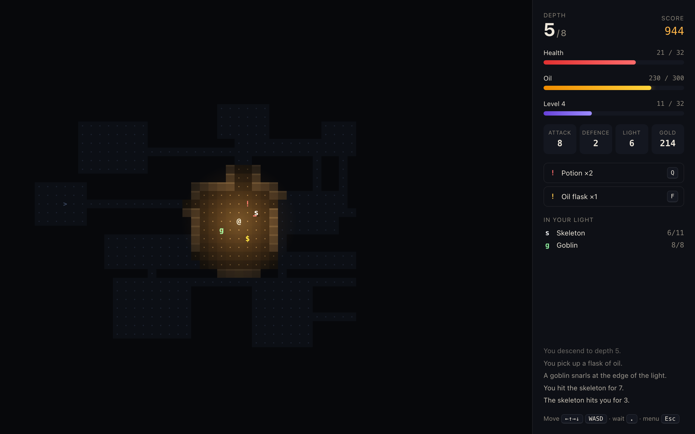
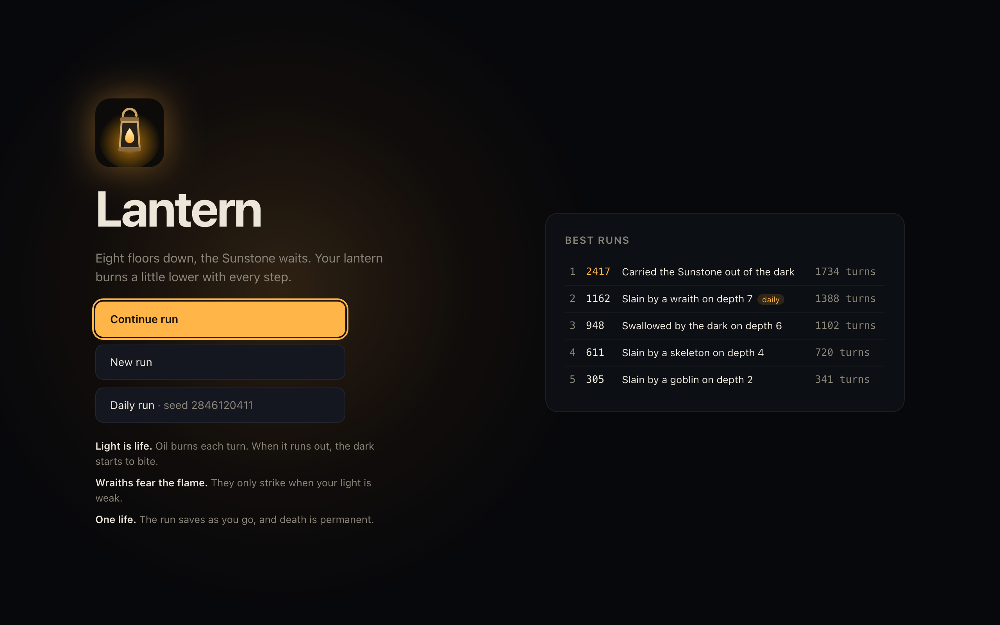
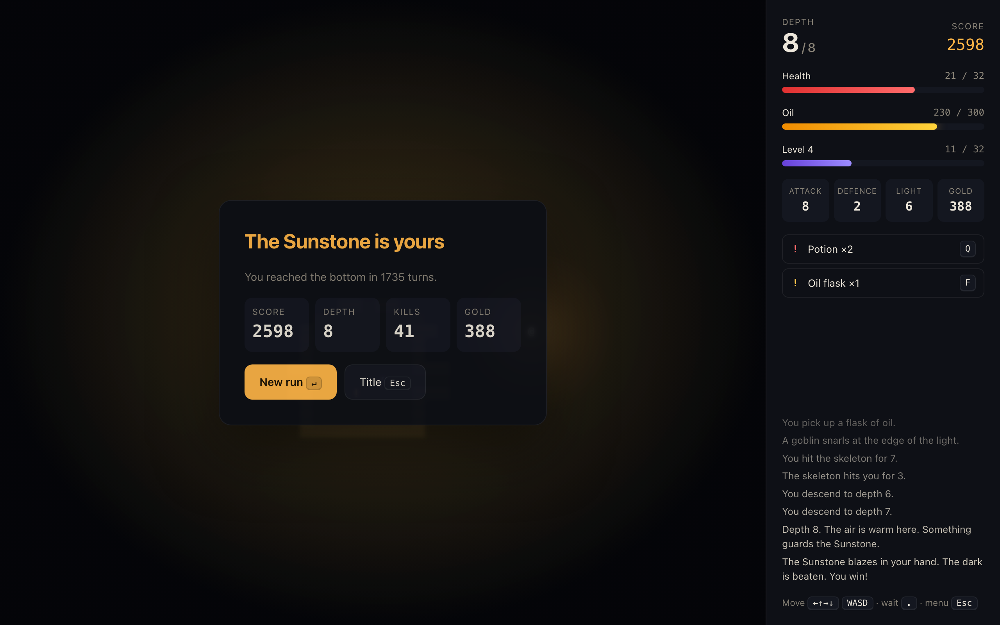

# Lantern

A turn-based roguelike for the desktop, built with **Tauri 2**, **Rust** and **React**. Eight floors down, the Sunstone waits. Your lantern burns a little lower with every step. The app bundle is about 4 MB.



## How it plays

- **Light is life.** The lantern burns one unit of oil per turn. Your light radius shrinks from 8 tiles to 1 as it empties, and once it is out the dark starts to bite. Oil flasks refill it.
- **Wraiths fear the flame.** They hang at the edge of your light and only close in when it weakens.
- **Bump to fight.** Rats, bats, goblins, skeletons and wraiths, then the Warden guarding the Sunstone on depth 8. Kills give XP. Each level adds max HP and attack.
- **Loot.** Healing potions, oil flasks, blades (+attack), mail (+defence) and gold.
- **One life.** The run autosaves every turn, and death is permanent. Finished runs go on a local top-10 board.
- **Daily run.** A seed derived from the UTC date, so everyone gets the same dungeon that day.

| Title and best runs | Victory |
| --- | --- |
|  |  |

### Controls

| Key | Action |
| --- | --- |
| Arrows, `WASD`, `hjkl`, numpad | Move or attack |
| `y` `u` `b` `n`, numpad 7 9 1 3 | Move diagonally |
| `.` `Space` `5` | Wait a turn |
| `>` `Enter` | Descend the stairs |
| `Q` | Drink a potion |
| `F` | Refill the lantern |
| `Esc` | Back to the title (the run is saved) |

## How it works

```
React UI ──invoke──▶ Tauri commands (src-tauri/src/lib.rs)
  canvas renderer       session, autosave, high scores in the app data dir
                         │
                         ▼
                    game core (src-tauri/src/game.rs)
                    pure and deterministic: seeded RNG, dungeon
                    generation, ray-cast field of view, monster AI
```

- All the rules live in Rust. The UI sends an action such as `{ "type": "move", "dx": 1, "dy": 0 }` and gets back a `View` with only the cells you can see or remember. The map can't leak through the frontend.
- Dungeons are random rooms joined by L-shaped corridors, with two extra links for loops. Every floor is generated from a SplitMix64 RNG that is saved with the run, so a loaded game continues exactly as it would have.
- Monsters path towards you on a breadth-first distance map. Wraiths walk up it when your light is strong.
- The lantern glow flickers on the canvas with layered sine noise, and the flicker is off when the system asks for reduced motion.

The core has 13 unit tests. They cover deterministic generation, floor connectivity across 200 seeds, light blocked by walls, oil and darkness, combat, wraith behaviour, the win condition, fog of war in the view, and save round trips. An ignored `balance_report` test plays 200 seeds with a simple bot and prints how far it gets.

## Develop

Requirements: Node 20+, Rust (stable), and the [Tauri prerequisites](https://tauri.app/start/prerequisites/) for your OS.

```sh
npm install
npm run tauri dev                                    # run the game
cd src-tauri && cargo test                           # core tests
cargo test --release balance -- --ignored --nocapture  # bot balance report
npm run tauri build                                  # release bundle
```

> **macOS note:** if linking fails with `tapi error: malformed file … unknown architecture`, your Command Line Tools ship an SDK newer than their linker. Point at an older SDK: `export SDKROOT=/Library/Developer/CommandLineTools/SDKs/MacOSX26.5.sdk`.

## Roadmap

- Ranged enemies and a throwable oil flask that sets an area alight
- Generated vaults and secret doors
- Sound: a lantern hiss that changes with your oil level
- Signed builds for macOS, Windows and Linux from CI

## License

MIT © Soe Moe Htet (Stephen)
